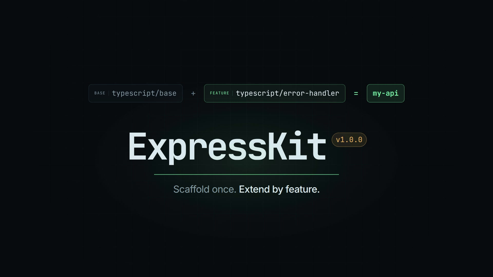

# ExpressKit

**Scaffold a clean Express API in seconds — JavaScript or TypeScript.**

[](docs/demo.mp4)

ExpressKit asks a few quick questions, then writes a ready-to-run Express 5 project. Choose JavaScript or TypeScript, optionally add centralized error handling, pick your linter and formatter, and start building.

## Quick start

Requires **Node.js 20+**.

```bash
npm create expresskit@latest
```

Or run it directly:

```bash
npx create-expresskit@latest
```

Answer the prompts:

```text
? Project name › my-api
? Language › TypeScript
? Create central error handling middleware? › Yes
? Which linter would you like to use? › ESLint
? Which formatter would you like to use? › Prettier
? Install dependencies? › Yes
```

Then:

```bash
cd my-api
npm run dev
```

Open <http://localhost:3000/health>.

Use `.` at the project name prompt to scaffold in the current directory. ExpressKit will not overwrite existing files.

## What you get

```text
my-api/
├── package.json
├── tsconfig.json          # TypeScript only
├── eslint.config.js       # with ESLint
├── .oxlintrc.json         # with Oxlint
├── biome.json             # with Biome (linter, formatter, or both)
├── .prettierrc            # with Prettier
├── .prettierignore        # with Prettier
└── src/
    ├── server.ts
    ├── app.ts
    ├── middleware/        # with the optional error handler
    │   ├── error.middleware.ts
    │   └── notFound.middleware.ts
    └── utils/
        ├── helpers.ts
        ├── responseHelpers.ts
        └── AppError.ts    # with the optional error handler
```

JavaScript projects use the same layout with `.js` files and no `tsconfig.json`.

### Scripts

| Command | Provider | Description |
| --- | --- | --- |
| `npm run dev` | Core | Start development server with file watching |
| `npm start` | Core | Run the application |
| `npm run typecheck` | Core (TS) | Run TypeScript compiler checks (`tsc --noEmit`) |
| `npm run lint` | ESLint / Biome / Oxlint | Lint source files |
| `npm run lint:fix` | ESLint / Biome / Oxlint | Auto-fix linting issues |
| `npm run format` | Prettier / Biome | Format source files |
| `npm run format:check` | Prettier / Biome | Check source files for formatting issues |
| `npm run check` | Biome (both) | Run formatting check, import sorting, and linting |

## Linters and formatters

ExpressKit supports modern, lightning-fast linting and formatting tools:

- **Linters**:
  - **ESLint**: Industry-standard linter configured with ESLint 9+ flat config (`eslint.config.js`), Node globals, and TypeScript support via `typescript-eslint`.
  - **Biome**: Rust-powered linter with instant feedback and safe fixes.
  - **Oxlint**: High-speed Rust-based linter from the OXC project with `.oxlintrc.json`.
  - **None**: Skip linter setup.

- **Formatters**:
  - **Prettier**: Opinionated code formatter with `.prettierrc` and `.prettierignore`.
  - **Biome**: High-performance code formatter configured with 2-space indentation.
  - **None**: Skip formatter setup.

### Tool combinations

- **Biome for both linting & formatting**: Generates a unified `biome.json` with both features enabled, plus `lint`, `lint:fix`, `format`, `format:check`, and `check` scripts.
- **ESLint + Prettier**: Automatically installs and configures `eslint-config-prettier` to disable ESLint rules that might conflict with Prettier.

## Error handling

With the error handler enabled, throw `BadRequestError`, `UnauthorizedError`, or `NotFoundError` from any route and one middleware formats the response:

```json
{
  "success": false,
  "message": "Route not found",
  "code": "NOT_FOUND"
}
```

Successful responses use the same envelope with `success: true` and `data`.

## How it works

Projects are assembled from a base template plus optional feature and tool layers. Feature and tool files replace base files at the same path, and `package.json` fragments are merged into the base manifest.

## Local development

```bash
npm install
npm run build
npm link
```

Then, in a separate directory:

```bash
mkdir -p /tmp/expresskit-test
cd /tmp/expresskit-test
create-expresskit
```

Rebuild with `npm run build` after changing `src/`; the linked command picks up the new `dist/` automatically. Remove the global link with `npm unlink -g create-expresskit`.

## License

MIT
